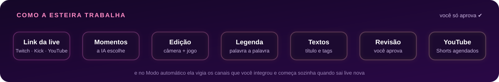

<div align="center">



### ✂️ Transforme lives em Shorts prontos para postar — sem editar nada na mão


[](LICENSE)
[](#apoie)

**[🚀 Instalar com IA](#instalar-com-ia)** · **[🛠️ Instalar sem IA](#instalar-sem-ia)** · **[🎬 Primeiros passos](#primeiros-passos)** · **[💜 Apoie o criador](#apoie)**

</div>

---

Cole o link de uma live da **Twitch**, da **Kick** ou do **YouTube**. A Esteira de Cortes baixa, encontra os
melhores momentos, monta o Short com a **câmera do streamer em cima e o jogo embaixo**, legenda **palavra por
palavra**, traduz o que for falado em outra língua, põe **música original sem Content ID** e escreve título,
descrição e hashtags. Você só assiste, aprova — e ela **agenda no seu canal do YouTube**.

Tudo roda **no seu computador**, num painel bonito no navegador (tema neon "Vice City"), e você opera tudo
**conversando em português** com a IA que preferir: Claude, ChatGPT ou Gemini.

<div align="center">

</div>

## ✨ O que ela faz

| | Recurso | Como funciona |
|---|---|---|
| 🔗 | **Corta por link** | Cole o link do vídeo da live (Twitch, Kick ou YouTube). Lives longas? Escolha só um trecho. |
| 📺 | **Aba Canais** | Integre **quantos canais quiser**; veja as lives de cada um e corte com um clique. |
| 🎯 | **IA escolhe os momentos** | Ouve a live e mede as reações (chat, mapa de calor, picos de áudio e fala) para separar os trechos com mais potencial. |
| 🎥 | **Layout inteligente** | Acha a webcam: tela dividida, vertical no rosto ou moldura com a foto e o @ do seu canal. |
| 💬 | **Legenda e tradução** | Legenda palavra por palavra; fala em inglês, espanhol etc. vira português. |
| 🎵 | **Música própria** | Compõe trilhas synthwave originais (sem dono no Content ID) ou usa as que você enviar. |
| ✍️ | **Textos com IA** | Gancho, título, descrição, tags e hashtags fixas do canal — você edita o que quiser. |
| ✅ | **Você aprova** | Nada vai ao ar sem o seu ok. Shorts com restrição (Content ID, idade) nunca são publicados. |
| 📅 | **Agenda no YouTube** | Publica nos horários do canal, um por vez, sem repetir o mesmo momento. |
| 🤖 | **Modo automático** | Vigia os canais que você marcar e corta sozinho quando sai live nova. |
| 🎬 | **Também faz vídeos do zero** | Canais "dark": pesquisa, roteiro, narração neural, montagem, Shorts e capas. |
| 👥 | **Com ou sem senha, você escolhe** | Use direto no seu PC, sem login, ou proteja com e-mail e senha e tenha uma equipe com contas separadas. Abre numa janela própria, como um app. |

---

<a name="instalar-com-ia"></a>
## 🚀 Instale em 3 passos com a sua IA favorita

A forma mais fácil: **uma IA de terminal instala e opera tudo para você**. Você só conversa em português — ela
roda os comandos, resolve os erros e abre o app. O projeto já vem com o manual que as três IAs leem sozinhas
(`CLAUDE.md`, `AGENTS.md` e `GEMINI.md`).

<div align="center">

</div>

### Passo 1 — Baixe o projeto

Clique no botão verde **`<> Code` → `Download ZIP`** aqui no GitHub e extraia a pasta. Ou, se você usa git:

```bash
git clone <link do repositório que aparece no botão Code>
cd esteira-de-cortes
```

> 📁 Nos comandos abaixo, `esteira-de-cortes` é a pasta do projeto. Se ela veio do ZIP, o nome termina em
> `-main` — use o nome que aparecer no seu computador.

> 💡 Precisa do **Python 3.10 a 3.13** (o 3.12 é o recomendado). Não tem? Depois de instalar a IA (passo 2),
> é só pedir: *"instale o Python 3.12 para mim"*.

### Passo 2 — Escolha e instale a sua IA

| | 🟠 **Claude Code** | 🟢 **Codex (ChatGPT)** | 🔵 **Gemini CLI** |
|---|---|---|---|
| **Empresa** | Anthropic | OpenAI | Google |
| **Conta** | Claude (Pro ou Max) ou chave de API | ChatGPT (plano com acesso ao Codex) | Google (tem cota gratuita) |
| **Precisa de Node.js?** | Não | Sim (versão 22 ou mais nova) | Sim (versão 20 ou mais nova) |
| **Lê o manual** | `CLAUDE.md` | `AGENTS.md` | `AGENTS.md` (via `.gemini/settings.json`) |

<details open>
<summary><b>🟠 Claude Code (Anthropic)</b></summary>

<br>

**Instale** (escolha o comando do seu sistema):

```bash
# macOS, Linux ou WSL
curl -fsSL https://claude.ai/install.sh | bash
```

```powershell
# Windows (PowerShell)
irm https://claude.ai/install.ps1 | iex
```

**Abra na pasta do projeto** e entre com a sua conta na primeira vez:

```bash
cd esteira-de-cortes
claude
```

> No Windows, instale também o [Git para Windows](https://git-scm.com/download/win) — o Claude Code usa ele
> para rodar os comandos. Prefere janela em vez de terminal? O app **Claude para desktop** tem a aba **Code**:
> abra a pasta do projeto nela e siga o passo 3.

</details>

<details>
<summary><b>🟢 Codex — o agente de terminal do ChatGPT (OpenAI)</b></summary>

<br>

**Instale o [Node.js](https://nodejs.org/) (versão LTS)** e depois o Codex:

```bash
npm install -g @openai/codex
```

> No macOS também dá: `brew install --cask codex`.

**Abra na pasta do projeto** e escolha **"Sign in with ChatGPT"** na primeira vez:

```bash
cd esteira-de-cortes
codex
```

O Codex lê o `AGENTS.md` sozinho — é o manual completo da esteira.

</details>

<details>
<summary><b>🔵 Gemini CLI (Google)</b></summary>

<br>

**Instale o [Node.js](https://nodejs.org/) (versão LTS)** e depois o Gemini CLI:

```bash
npm install -g @google/gemini-cli
```

> Quer só experimentar sem instalar? `npx @google/gemini-cli`.

**Abra na pasta do projeto** e entre com a sua conta Google na primeira vez:

```bash
cd esteira-de-cortes
gemini
```

O projeto já traz o `.gemini/settings.json`, que faz o Gemini carregar o `AGENTS.md`. Para conferir, digite
`/memory show`.

</details>

### Passo 3 — Cole este pedido 💬

Funciona igual nas três IAs:

```text
Instale a Esteira de Cortes neste computador seguindo o AGENTS.md: rode o instalador do projeto,
resolva o que o diagnóstico marcar com ✖ e, no fim, abra o app. Fale comigo em português.
```

A IA vai pedir permissão para rodar os comandos — é só aprovar. Em alguns minutos o painel abre no navegador
em **`http://127.0.0.1:8765`** 🎉

**Depois, é só conversar.** Alguns pedidos que funcionam:

> 🗨️ *"Crie um canal de cortes para mim."*<br>
> 🗨️ *"Conecte o meu canal do YouTube."*<br>
> 🗨️ *"Integre o canal twitch.tv/fulano — ele permite cortes."*<br>
> 🗨️ *"Corte esta live: https://www.twitch.tv/videos/…"*<br>
> 🗨️ *"Troque o gancho do Short 2 e melhore os títulos."*<br>
> 🗨️ *"Fique de olho nas lives e corte sozinho as novas."*<br>
> 🗨️ *"Crie um vídeo sobre o mistério do navio Mary Celeste."*

---

<a name="instalar-sem-ia"></a>
## 🛠️ Prefere instalar sem IA?

Pré-requisitos: **Python 3.10 a 3.13** (3.12 recomendado) e internet durante a instalação.

| Sistema | Comando |
|---|---|
| 🪟 Windows | clique duas vezes em `instalar.bat` (ou `py -3.12 instalar.py`) |
| 🍎 macOS / 🐧 Linux | `./instalar.sh` (ou `python3 instalar.py`) |

Depois abra o app:

```bash
python esteira.py app
```

<details>
<summary><b>O que o instalador faz, passo a passo</b></summary>

<br>

1. cria o ambiente virtual `.venv` (tenta outras versões do Python, `uv` e `virtualenv` se precisar);
2. instala as dependências do `requirements.txt`;
3. baixa o **Chromium headless** do Playwright (usado nos motion graphics e nas capas). Não é preciso
   instalar Node à parte para isso;
4. verifica o **FFmpeg** (no Windows instala via `winget`, no macOS via `brew`; no Linux mostra o comando);
5. baixa as fontes (Anton, Bebas Neue, Archivo Black, DM Serif Display, Special Elite, Poppins);
6. cria o `.env` a partir do `.env.example`;
7. baixa os modelos locais: **Kokoro v1.0 int8** (voz, ~115 MB) e **Faster-Whisper** (`small` por padrão);
8. roda o diagnóstico.

Opções: `--sem-modelos` (baixa depois com `python esteira.py modelos baixar`), `--whisper base` (modelo menor,
mais rápido) e `--kokoro completo` (voz fp32, ~310 MB).

No Linux, se o Chromium reclamar de bibliotecas: `sudo .venv/bin/python -m playwright install-deps chromium`.

Para gerar um instalador `.exe` para Windows (instala Python, FFmpeg e Deno portáteis, sem administrador):
`python instalador/construir_exe.py` → `dist/EsteiraDeCortes-Instalador.exe`.

</details>

---

<a name="primeiros-passos"></a>
## 🎬 Primeiros passos

O projeto vem **zerado**: sem contas, sem canais, sem nada seu. Na primeira vez:

1. **Abra o app** — `python esteira.py app` (ou peça à IA). O painel abre em http://127.0.0.1:8765.
2. **Primeiro acesso: com ou sem senha?** — escolha como quer entrar:
   - 🔓 **Usar sem senha** — abre direto neste computador. Ideal se só você usa o PC.
   - 🔒 **Proteger com e-mail e senha** — pede login. Ideal se outras pessoas usam o PC ou se você quer uma equipe.

   Dá para mudar depois em **Conta → Senha e acesso**. Mesmo sem senha, o painel só abre no próprio computador:
   pela rede ele continua fechado. E-mail e senha ficam guardados só no seu PC.
3. **Crie o seu canal** — **Conta → Seus canais → Criar canal** (para cortes, escolha o tipo *cortes*).
4. **Conecte o YouTube** — siga o guia [credenciais/LEIA-ME.md](credenciais/LEIA-ME.md) uma vez e clique no
   selo do canal no topo do painel.
5. **Integre os canais das lives** — aba **Canais**: cole o link do canal (Twitch, Kick ou YouTube), diga se é
   seu ou se o criador autorizou, e marque **Vigiar** se quiser o Modo automático. Guia completo em
   [docs/LEIA-ME-CANAIS.md](docs/LEIA-ME-CANAIS.md).
6. **Corte!** — na aba **Painel**, cole o link de uma live e clique em **✂ Cortar este link**. Escolha
   **⚡ Tudo automático** ou **🎛 Passo a passo**.
7. **Revise e aprove** — acompanhe o pipeline *Baixar → Momentos → Editar → Legenda → Textos → Revisão →
   Publicar*, ajuste o que quiser e aprove. Os Shorts vão para a agenda do YouTube.

<details>
<summary><b>🔑 Chaves opcionais (deixam tudo melhor, mas nenhuma é obrigatória)</b></summary>

<br>

Edite o `.env` (ou, no painel, **Conta → Conexões** — as chaves ficam cifradas e valem só para a sua conta):

- **IA de texto** (`ANTHROPIC_API_KEY`, ou OpenAI, Gemini, Groq, OpenRouter, Ollama local). Sem chave, a própria
  IA de terminal escreve os textos (`--modo-agente`) ou a esteira usa sugestões automáticas.
- **Pexels / Pixabay** (grátis) para vídeos de banco nos vídeos do zero. Sem elas, usa imagens Creative Commons
  do Openverse e cenas ilustradas 2D.
- **Imagens por IA**: Pollinations (grátis) ou um comando local (ex.: Stable Diffusion na GPU).
- **YouTube**: siga [credenciais/LEIA-ME.md](credenciais/LEIA-ME.md) e rode
  `python esteira.py youtube autenticar --canal <seu_canal>`.

</details>

<details>
<summary><b>🎬 Vídeos longos do zero (canais "dark")</b></summary>

<br>

Além dos cortes, a esteira produz vídeos completos a partir de um tema ou de um roteiro:
pesquisa e roteiro → narração neural com auditoria de pronúncia → montagem com motion graphics →
Shorts verticais e capas → painel de aprovação → agendamento no YouTube.

```bash
python esteira.py canal criar --nome "Meu Canal" --nicho "mistérios históricos" --tom "sombrio e investigativo" --paleta "preto e vermelho" --ritmo medio
python esteira.py produzir --canal meu_canal --tema "O navio fantasma Mary Celeste"
```

- Funciona em computadores **sem placa de vídeo** (tudo roda na CPU). Com GPU, ela é usada automaticamente
  para codificar o vídeo (NVENC/VideoToolbox/QSV/AMF) e para o Whisper (CUDA).
- Cada etapa grava **artefatos em disco** com **cache por bloco**: ao reprovar "a imagem da cena 4", só a
  cena 4 é refeita.
- A narração usa um só motor de voz no vídeo inteiro (Kokoro local; se errar demais a pronúncia, refaz tudo
  com o Edge-TTS para não misturar vozes).

</details>

<details>
<summary><b>🧭 Como funciona por dentro</b></summary>

<br>

**Cortes de lives**

```
 link da live (Twitch/Kick/YouTube) ou live de um dos canais integrados (aba Canais)
     ─▶ Olheiro: confere de quem é a live (criador novo: "ele permite cortes?") e baixa —
         Twitch/Kick: só o trecho, em 480p para a análise; YouTube: a live em 720p30 + legendas
     ─▶ Analista: chat, mapa de calor, picos de áudio e fala → candidatos → os melhores momentos
     ─▶ Tradutor: fala em outra língua vira legenda/gancho/título em português
     ─▶ Editor: baixa cada momento em 1080p e acha a webcam — tela dividida, vertical no rosto ou
         moldura do canal; zoom nos picos de reação, realce, voz tratada, legenda, trilha, -14 LUFS
     ─▶ Redator: título, descrição com o link do momento, hashtags fixas do canal e tags
     ─▶ Painel: Baixar → Momentos → Editar → Legenda → Textos → Revisão → Publicar
     ─▶ YouTube: agenda nos horários do canal
 Modo automático ─▶ vigia os canais marcados na aba Canais e corta a live nova sozinho
```

**Vídeos do zero**

```
 tema ou roteiro ─▶ [1] Pesquisa + anti-duplicidade (SQLite) + roteiro em blocos de 5–12 s + SEO
                    [2] Voz por bloco (Kokoro local → Edge-TTS) → Whisper confere → regera se errar
                    [3] Cenas (cartões animados, vídeos de banco, imagens IA, ilustração 2D, tipografia)
                        + transições + logo + trilha com ducking + -14 LUFS / -1.5 dBTP
                    [4] Até 3 Shorts 9:16 com legenda palavra por palavra + 3 capas 1280x720
                    [5] Painel web: assistir, editar SEO, escolher capa, Aprovar / Reprovar
                    [6] YouTube Data API v3: envio privado com publishAt no próximo horário livre
   worker diário ─▶ consome a fila do canal sozinho (systemd / cron / launchd / Agendador do Windows)
```

A equipe de IA (olheiro, analista, editor, redator e revisor) fica em `.claude/agents/`. Detalhes da
plataforma multiusuário em [docs/PLATAFORMA.md](docs/PLATAFORMA.md); manual de operação em [AGENTS.md](AGENTS.md).

</details>

<details>
<summary><b>🗂️ Mapa de arquivos</b></summary>

<br>

```
esteira-de-cortes/
├── AGENTS.md / CLAUDE.md / GEMINI.md   manual das IAs (Codex, Claude Code e Gemini CLI)
├── .gemini/settings.json     faz o Gemini CLI carregar o AGENTS.md
├── .claude/agents/           equipe de cortes (subagentes do Claude Code)
├── README.md                 este guia · docs/imagens/ (banner, animações e QR do PIX)
├── LICENSE                   licença MIT
├── .env.example              modelo de variáveis (chaves de API, voz, vídeo, YouTube)
├── instalar.py / .sh / .bat  instalação automática (venv, pacotes, Chromium, FFmpeg, fontes, modelos)
├── esteira.py                linha de comando única (todos os comandos)
├── esteira/                  motor: configuração, FFmpeg, canais, histórico, LLM, pesquisa, mídia
│   ├── cortes/               fontes, ingestão (yt-dlp), análise, câmera, edição, hashtags, orquestrador
│   └── modulos/              roteiro, narração, montagem, Shorts, capas e publicação no YouTube
├── painel/                   plataforma web (FastAPI + HTML/CSS/JS em módulos, sem build)
├── templates/                cenas animadas e modelos de capa (HTML/CSS)
├── canais/                   vem vazia: cada canal criado ganha a sua pasta (fora do git)
├── credenciais/LEIA-ME.md    como criar o acesso ao YouTube (client_secret.json)
├── docs/                     guias (aba Canais, plataforma) e imagens do README
├── instalador/               gerador do instalador .exe para Windows
└── testes/                   testes rápidos (offline) e o teste ponta a ponta
```

Tudo o que é pessoal — `.env`, contas (`dados/`), canais, vídeos (`projetos/`), modelos e logs — fica **fora do
git** pelo `.gitignore`.

</details>

<details>
<summary><b>⚡ Desempenho e testes</b></summary>

<br>

Numa máquina modesta (4 núcleos, 8 GB de RAM, sem GPU), um vídeo de 50 segundos levou cerca de 6 minutos de
ponta a ponta. Para acelerar: `WHISPER_MODELO=base`, transição `corte` ou uma máquina com GPU.

```bash
python esteira.py diagnostico          # confere o ambiente
python testes/teste_cortes.py          # cortes de lives (rápido, offline)
python testes/teste_plataforma.py      # painel, contas e etapas (rápido, offline)
python testes/teste_fumaca.py          # ponta a ponta: cria um canal temporário e produz um vídeo
```

</details>

## ⚠️ Avisos importantes

- **Só corte quem permite.** Cortar lives de terceiros sem autorização gera reivindicações e *strikes*. A esteira
  só processa canais cadastrados como seus ou com a autorização descrita, e sempre põe o crédito e o link da live
  na tela e na descrição.
- **Música:** use só trilhas livres. Música oficial de jogos e de artistas **não é livre**. As trilhas
  `synthwave_*` são compostas pela própria esteira.
- **API do YouTube:** projetos não verificados pelo Google publicam como privado até a verificação, e a cota
  diária é limitada. Veja [credenciais/LEIA-ME.md](credenciais/LEIA-ME.md).
- **Conteúdo sintético:** o envio marca o campo de conteúdo gerado por IA, como pede a política do YouTube.
- **Espaço em disco:** lives longas ocupam de 0,3 a 1 GB por hora em 1080p (em `projetos/`).

## 📄 Licença

Código aberto sob a **[licença MIT](LICENSE)**: você pode usar, estudar, modificar, distribuir e até usar
comercialmente, de graça. A única condição é manter o aviso de direitos autorais e a licença nas cópias. O
programa é oferecido "como está", sem garantias.

---

<a name="apoie"></a>
## 💜 Apoie o criador

<div align="center">

Este projeto é **gratuito** e foi feito com muitas noites em claro, café e neon. ☕✨

Se a Esteira de Cortes economizou o seu tempo, te ajudou a crescer um canal ou só te deu uma boa ideia,
considere mandar um **PIX de qualquer valor** para o criador. Cada apoio ajuda a manter o projeto vivo,
com correções, novos recursos e novas integrações. 🙏


**Abra o app do seu banco → Pix → Ler QR Code** e escolha o valor.

**Chave PIX aleatória:**

`b6ea36ce-f8b1-479e-a8c8-8ab0f4575bb2`

</div>

<details>
<summary><b>📋 Prefere o Pix Copia e Cola?</b></summary>

<br>

Copie o código abaixo e cole em **Pix → Pix Copia e Cola** no app do seu banco:

```text
00020126580014br.gov.bcb.pix0136b6ea36ce-f8b1-479e-a8c8-8ab0f4575bb25204000053039865802BR5917ESTEIRA DE CORTES6006BRASIL62070503***63042EAD
```

</details>

<div align="center">

**Obrigado por apoiar! Bons cortes e muitos views.** 🌴🌅

<sub>Feito com 💜 no Brasil · deixe uma ⭐ no repositório se ele te ajudou</sub>

</div>
